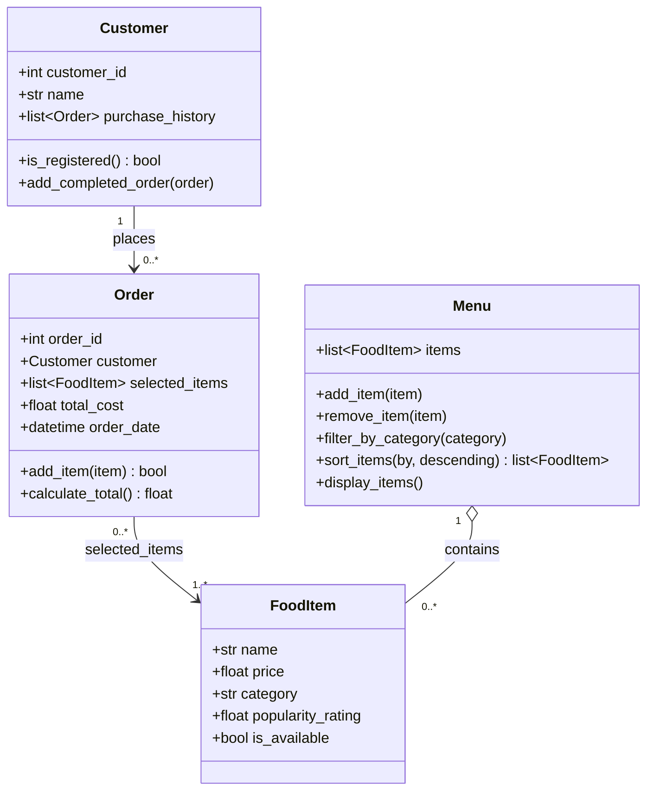

# ByteBites Design

Backend logic for a campus food ordering app, built with Python classes and simple algorithms.
Out of scope: authentication, a database layer, and any feature not in the spec.

## UML class diagram

## Classes

### Customer
Stores customer information and past purchase history.
- `customer_id`: unique identifier
- `name`: customer's name
- `purchase_history`: list of completed `Order` objects
- `is_registered()`: simple check that the customer has an ID (no authentication logic)
- `add_completed_order(order)`: records a finished order in the history

### FoodItem
An individual food or drink product. Data only, no methods.
- `name`, `price`, `category`, `popularity_rating`
- `is_available`: whether the item can be added to an order

### Menu
Manages the collection of food items.
- `items`: list of `FoodItem` objects
- `add_item()`, `remove_item()`, `filter_by_category()`, `display_items()`
- `sort_items(by, descending)`: returns a new list sorted by `price`, `name`, or `popularity_rating` (added beyond the spec)

### Order
A customer's transaction.
- `order_id`: unique identifier
- `customer`: the `Customer` who placed it
- `selected_items`: list of `FoodItem` objects
- `total_cost`: always computed from `selected_items`, never entered manually
- `order_date`: date and time the order was placed
- `add_item(item)`: adds an item only if `item.is_available` is true; returns whether it was added
- `calculate_total()`: sums the prices of the current `selected_items`

## Relationships

- A `Customer` places zero or more `Order` objects.
- An `Order` contains one or more `FoodItem` objects.
- A `Menu` contains (aggregates) many `FoodItem` objects.
- `Menu` and `Order` are deliberately not linked, keeping menu management separate from order processing.

## Design rules

- Every customer and order has a unique ID.
- Check availability before adding a food item to an order.
- Calculate order totals from the current selected items.
- Store purchase history through completed orders to avoid duplicating customer data.