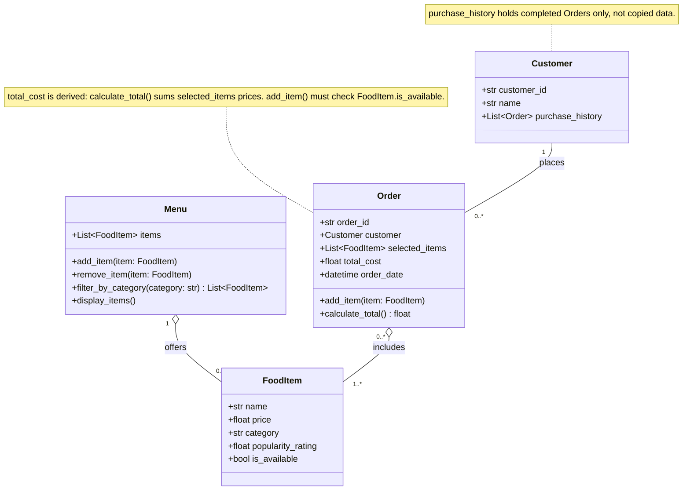

# ByteBites UML Class Diagram (Draft from Copilot)

Source: `bytebites_spec.md`

## Class Diagram

## Relationships

| Relationship | Multiplicity | Type | Reasoning |
|---|---|---|---|
| Customer - Order | 1 to 0..* | Association | A customer can place many orders; each order has one customer. Navigable both ways (`Order.customer`, `Customer.purchase_history`). |
| Menu - FoodItem | 1 to 0..* | Aggregation | A menu offers many items; items exist independently of the menu. |
| Order - FoodItem | 0..* to 1..* | Aggregation | An order has one or more items; the same FoodItem can appear in many orders. |

## Audit Against the Spec

- **Classes not in the candidate list:** None. Only Customer, FoodItem, Menu, and Order appear.
- **Missing attributes or methods:** None from the listed spec. The prose-only "verify whether a customer is a registered user" has no listed method, so it is not in the diagram.
- **Inconsistencies fixed from the first draft:**
  1. `Order` to `FoodItem` multiplicity changed from `1` to `0..*` on the Order side, since one FoodItem appears in many orders.
  2. `total_cost` is documented as derived from `selected_items`, matching the spec.
  3. Customer-Order is drawn as a two-way association to match both `Order.customer` and `Customer.purchase_history`.

## One Sentence Per Class

- **Customer:** a person who orders food, identified by ID, with their past orders attached.
- **FoodItem:** a single menu product with a price, category, popularity, and availability.
- **Menu:** the manager of the collection of FoodItems, handling add, remove, filter, and display.
- **Order:** one customer's transaction, holding chosen items and computing their total.

## Open Questions / Assumptions

- [ ] Should an Order require at least one item at creation, or only at checkout?
- [ ] No quantity attribute exists. Is repeating the same FoodItem in `selected_items` acceptable?
- [ ] What should `add_item()` do for an unavailable item: raise an error, return `False`, or skip it?
- [ ] Should Customer get an `is_registered()` method, or is that a separate concept?
- [ ] IDs are typed as `str` (e.g., UUIDs) since the spec only says "unique identifier." Confirm.

## Prompt Used

Using #file:bytebites_spec.md as the source of truth, generate a UML class
diagram in Mermaid `classDiagram` syntax for the four classes: Customer,
FoodItem, Menu, and Order.

Requirements:
- Show every attribute and method listed in the spec, with visibility
  markers and type hints (e.g., +price: float).
- Show relationships with correct UML notation and multiplicity:
  Customer 1 -> 0..* Order, Menu 1 o-- 0..* FoodItem, and
  Order 0..* o-- 1..* FoodItem. Label each relationship.
- Don't add classes, attributes, or methods that aren't in the spec. If
  something in the spec seems ambiguous or missing, list it separately
  under "Assumptions / questions" instead of silently adding it.
- Output the Mermaid code block first, then a short bullet list explaining
  your relationship choices.

After the diagram, audit it against the spec: list any classes, attributes,
or methods not in the spec, any spec items missing from the diagram, and
any multiplicity that doesn't make sense from both sides of the relationship.
